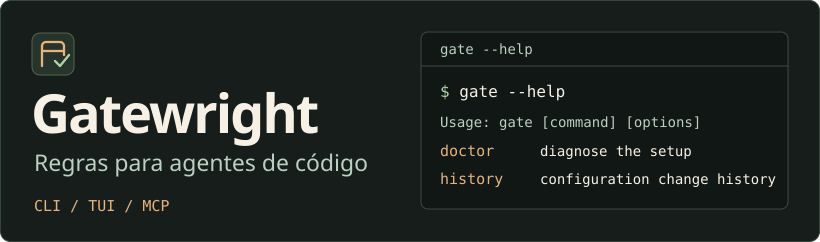
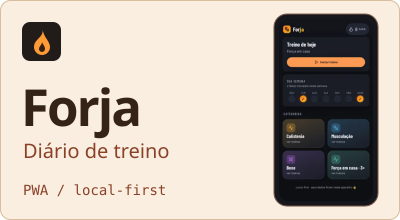

  

Sou o Rafa. Trabalho com front-end e design. Nos meus projetos, vou de uma CLI pra agentes de código a um caderno de treino que roda no navegador.

  &nbsp;
  &nbsp;
  &nbsp;
  

## Gatewright

  

O Gatewright leva as regras do projeto pra dentro do fluxo do agente. Se ele tenta ler um `.env` ou editar algo fora do escopo, o Gatewright pode bloquear a ação e deixar o motivo no histórico. As regras ficam versionadas junto do código. [Licença MIT](https://github.com/rfsants001/gatewright/blob/main/LICENSE).

  
  

## Outros projetos

  
  

- **[Forja](https://github.com/rfsants001/forja)** guarda os treinos no seu dispositivo e usa o histórico pra sugerir carga e repetições na próxima sessão. É instalável como PWA. Licença a definir.
- **[Dungeon Forge](https://github.com/rfsants001/dungeon-forge)** gera mapas de masmorras pra sessões de D&D e outros RPGs de mesa. Usa React, TypeScript e Canvas. [Licença MIT](https://github.com/rfsants001/dungeon-forge/blob/main/LICENSE).

  
Ver duas telas da Forja

   
  

