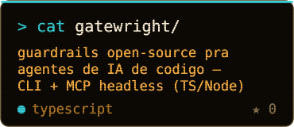

<code>&gt; connect:</code>
<a href="https://www.linkedin.com/in/rafadevx/"><kbd>&nbsp;linkedin&nbsp;</kbd></a>
<a href="https://www.instagram.com/rafa.devx/"><kbd>&nbsp;instagram&nbsp;</kbd></a>
<a href="https://medium.com/@rf.sants001"><kbd>&nbsp;medium&nbsp;</kbd></a>

<code>&gt; git log --coming-soon</code>&nbsp;&nbsp;`smartcart` · `habithub` · `nyx` · `legendador` · `lifeos` — publicando 1/semana

