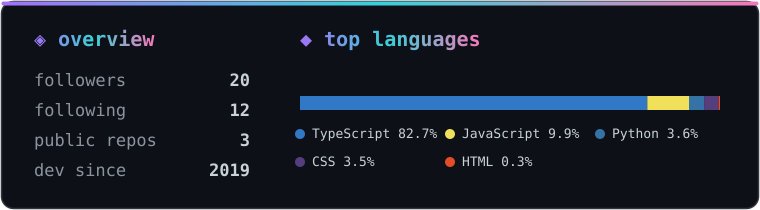

 

 

**`< Developer Consultant / UI•UX Designer >`**
📍 Mogi das Cruzes · SP · 🌎 remoto

  

### 🧰 Stack

<table align="center" border="0">
<tr>
<td align="right"><b>Front</b></td>
<td></td>
</tr>
<tr>
<td align="right"><b>Back</b></td>
<td></td>
</tr>
<tr>
<td align="right"><b>Tools</b></td>
<td></td>
</tr>
</table>

### 📊 Métricas

### 🚀 Projetos

**Chegando — publicando 1 por semana nos próximos 60 dias:**

`🛒 smartcart` lê NFC-e por QR e planeja o mês · `🌱 habithub` hábitos em grafo de contribuições · `🤖 nyx` IA rodando 100% local · `🎬 legendador` legenda vídeo offline · `🗂️ lifeos` suíte pessoal gamificada

⚡ Construindo em público — 1 projeto por semana. Me chama no LinkedIn pra projeto PJ.

