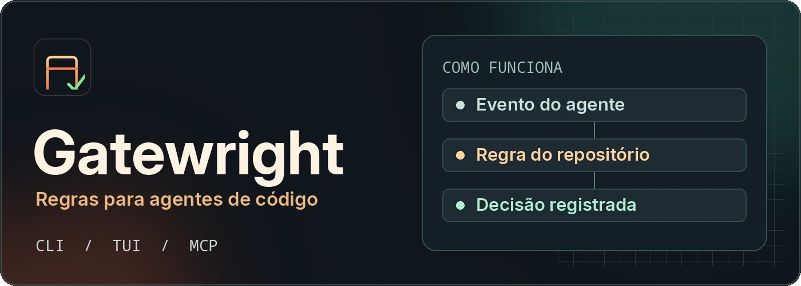
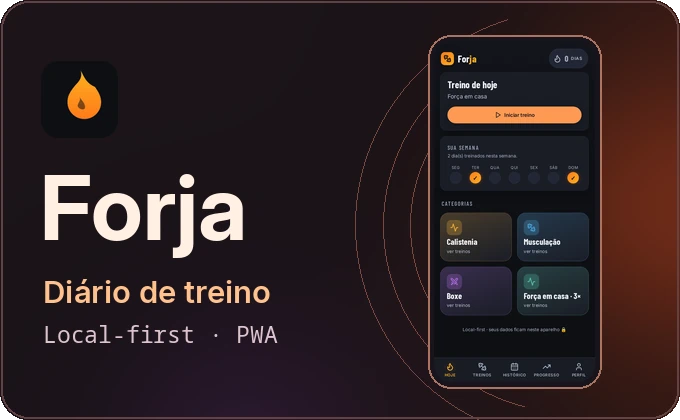
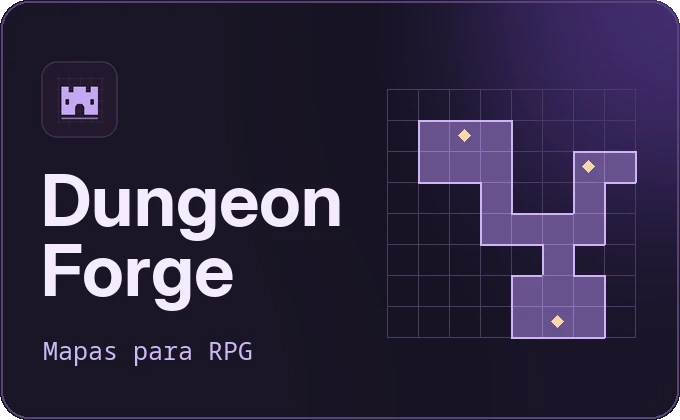
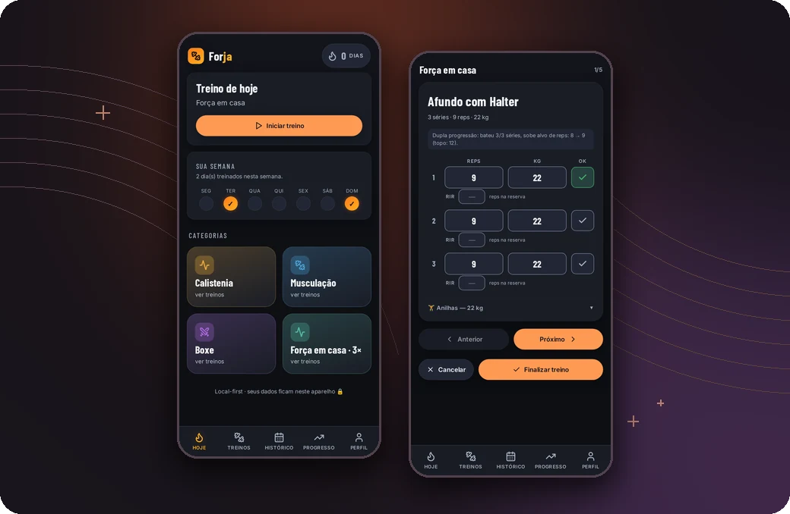

  

Sou Rafael, desenvolvedor front-end e designer. Por aqui você encontra as ferramentas que crio para quem programa, treina ou mestra RPG.

**[Portfólio](https://rfsants001.github.io/rfsants001/) · [LinkedIn](https://www.linkedin.com/in/rafadevx/) · [Medium](https://medium.com/@rf.sants001) · [Instagram](https://www.instagram.com/rafa.devx/)**

## Em destaque · Gatewright

  

Quando um agente de código sai do escopo ou tenta ler um arquivo sensível, o **Gatewright** aplica as regras do projeto e registra a decisão. As regras ficam versionadas junto do código. Dá para usar pelo terminal ou integrar com um servidor MCP local.

[**Ver o código ↗**](https://github.com/rfsants001/gatewright) · [Guia de instalação](https://github.com/rfsants001/gatewright#install) · [Licença MIT](https://github.com/rfsants001/gatewright/blob/main/LICENSE)

## Outros projetos

  
  

- **[Forja](https://github.com/rfsants001/forja)** · Diário de treino que sugere carga e repetições a partir do seu histórico. É instalável como PWA e salva os dados no dispositivo. Licença a definir.
- **[Dungeon Forge](https://github.com/rfsants001/dungeon-forge)** · Gerador procedural de masmorras para D&D e outros RPGs de mesa, feito com React, TypeScript e Canvas. [Licença MIT](https://github.com/rfsants001/dungeon-forge/blob/main/LICENSE).

  
Ver duas telas da Forja

   
  

