<a href="https://www.linkedin.com/in/rafadevx/"><code>&gt; linkedin</code></a>  ·  <a href="https://www.instagram.com/rafa.devx/"><code>instagram</code></a>  ·  <a href="https://medium.com/@rf.sants001"><code>medium</code></a>

<code>&gt; git log --coming-soon</code>&nbsp;&nbsp;`smartcart` · `habithub` · `nyx` · `legendador` · `lifeos` — publicando 1/semana

