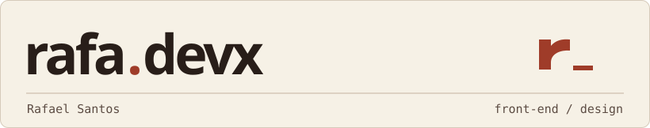
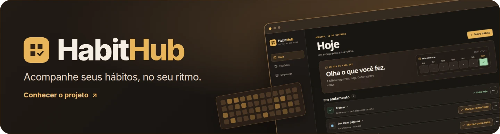
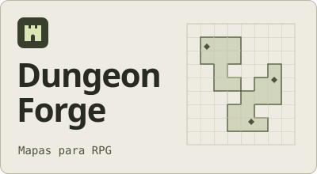
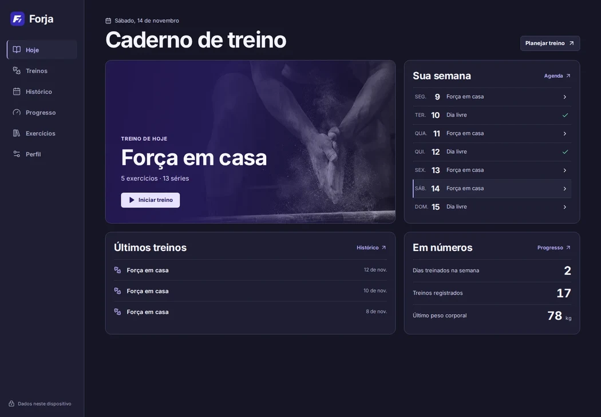

  

Sou o Rafa. Trabalho com front-end e design. Nos meus projetos, vou de uma CLI pra agentes de código a um caderno de treino que roda no navegador.

  &nbsp;
  &nbsp;
  &nbsp;
  

## Gatewright

O Gatewright leva as regras do repositório pra dentro do fluxo dos agentes de código. Ele pode bloquear ações como a leitura de um `.env` e registra o motivo no histórico. No desktop, dá pra conectar agentes, acompanhar execuções, revisar mudanças e ver o consumo por dia e por modelo.

  

[Ver telas do desktop](https://github.com/rfsants001/gatewright#desktop-screenshots) · [Licença MIT](https://github.com/rfsants001/gatewright/blob/main/LICENSE).

  
  

## HabitHub

  

O HabitHub é meu app pra acompanhar hábitos diários e metas de frequência semanal. Dá pra marcar o que fez, rever o histórico e baixar um backup. Ele roda no navegador e você pode hospedar na sua própria máquina ou servidor. [Como instalar](https://github.com/rfsants001/habithub#install).

## Outros projetos

  
  

- **[Forja](https://github.com/rfsants001/forja)** é meu diário de treino de força. Dá pra planejar a semana, registrar séries e ver o que tentar no próximo treino. Roda no desktop e no celular, com instalação como PWA. [Ver as telas](https://github.com/rfsants001/forja#telas) · [Rodar localmente](https://github.com/rfsants001/forja#rodar-localmente).
- **[Dungeon Forge](https://github.com/rfsants001/dungeon-forge)** gera mapas de masmorras pra sessões de D&D e outros RPGs de mesa. Usa React, TypeScript e Canvas. [Licença MIT](https://github.com/rfsants001/dungeon-forge/blob/main/LICENSE).

  
Ver a Forja no desktop e no celular

   
  
  

    
    
  

